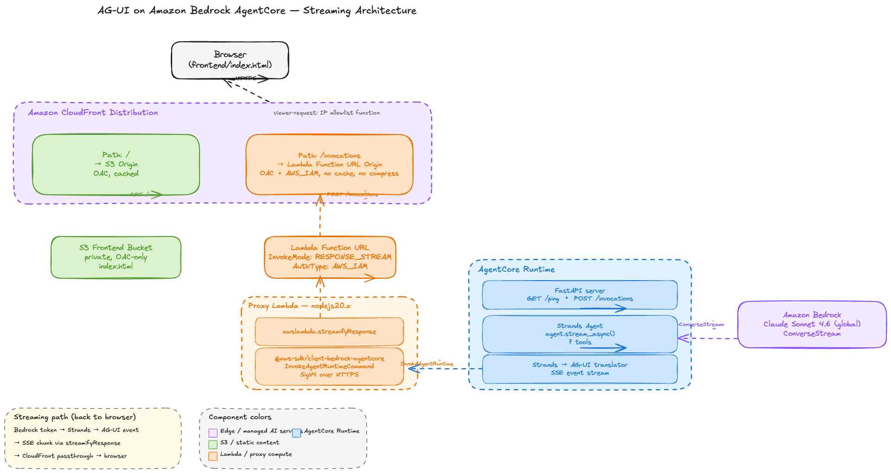

# AG-UI with Amazon Bedrock AgentCore

Real-time AI agent interfaces using the [AG-UI protocol](https://docs.ag-ui.com) and [Amazon Bedrock AgentCore](https://docs.aws.amazon.com/bedrock/latest/userguide/agentcore.html). Stream every reasoning step, tool call, and state change from your agent to the browser as they happen — no buffering, no waiting for the full response.

## Overview

Most agent-powered applications show a loading spinner and a final answer. This project implements the AG-UI (Agent-User Interaction Protocol) to stream the full agent execution pipeline — text tokens, tool invocations with arguments, tool results, and state changes — to a frontend in real time.

The agent is built with the [Strands Agents SDK](https://github.com/strands-agents/sdk-python) and deployed on AgentCore Runtime. It uses Strands' `agent.stream_async()` API, translating each Strands event into an AG-UI event as the model emits it. A Node.js Lambda proxy uses Function URL response streaming (`awslambda.streamifyResponse`) to forward the SSE bytes through CloudFront to the browser without buffering.

## Architecture



The source for the diagram is at [`docs/architecture.excalidraw.json`](docs/architecture.excalidraw.json) — open it in [Excalidraw](https://excalidraw.com) to edit.

### Request flow

```text
Browser ─POST /invocations─► CloudFront ─/invocations─► Lambda Function URL
                                  │                            │
                                  └─/─► S3 (frontend HTML)     ▼
                                                       Node.js Streaming Proxy
                                                       awslambda.streamifyResponse
                                                               │
                                                       SigV4 + InvokeAgentRuntime
                                                               ▼
                                                       AgentCore Runtime
                                                       FastAPI + Strands Agent
                                                               │
                                                       agent.stream_async()
                                                               │
                                                               ▼
                                                       Bedrock ConverseStream
                                                       (Claude Sonnet 4.6, global)
```

### Components

- **AgentCore Runtime** — Strands agent with 7 tools (search, calculator, inventory, trends, customer lookup, report generation, alerts) running as a managed container. Translates Strands streaming events into AG-UI Server-Sent Events. Calls Bedrock Claude via the streaming Converse API.
- **Lambda Streaming Proxy** — Node.js 20.x function with `InvokeMode: RESPONSE_STREAM`. Receives the browser's POST, calls `InvokeAgentRuntimeCommand` against AgentCore, and pipes each SSE chunk through `awslambda.streamifyResponse` without accumulating the response.
- **Lambda Function URL** — `AuthType: AWS_IAM`. CloudFront is the only intended caller; access is enforced by Origin Access Control (OAC for Lambda, signs origin requests with SigV4).
- **CloudFront Distribution** — Single domain serving both static content and the streaming API.
  - `/` → S3 origin (frontend HTML, OAC-protected)
  - `/invocations` → Lambda Function URL origin (OAC-protected, no caching)
  - Viewer-request CloudFront Function enforces an IP allowlist (set via `AllowedIPv4CIDR` parameter)
- **S3 Frontend Bucket** — Private, served only via CloudFront OAC. Single-page `index.html` containing the AG-UI client.

## AG-UI Event Flow

The protocol defines 16 event types in three streaming patterns:

| Pattern | Events | Description |
| --- | --- | --- |
| Start-Content-End | `TEXT_MESSAGE_START` → `TEXT_MESSAGE_CONTENT` → `TEXT_MESSAGE_END` | Token-by-token text streaming |
| Start-Content-End | `TOOL_CALL_START` → `TOOL_CALL_ARGS` → `TOOL_CALL_END` → `TOOL_CALL_RESULT` | Tool invocation with arguments and results |
| Snapshot-Delta | `STATE_SNAPSHOT` / `STATE_DELTA` | Full state then incremental updates |
| Lifecycle | `RUN_STARTED` / `RUN_FINISHED` / `RUN_ERROR` | Execution boundaries |

## Agent Tools

| Tool | Description |
| --- | --- |
| `search_knowledge_base` | Search internal knowledge bases |
| `calculator` | Evaluate mathematical expressions |
| `get_inventory` | Query warehouse inventory by status |
| `analyze_trends` | Analyze business trends over time |
| `lookup_customer` | Look up customer records |
| `generate_report` | Generate formatted reports |
| `send_alert` | Send notifications via Slack, email, or PagerDuty |

## Getting Started

The `agui_bedrock_agentcore_deploy.ipynb` notebook deploys everything end-to-end: the supporting CloudFormation stack (Lambda streaming proxy + S3 + CloudFront), the Strands agent on AgentCore Runtime, the frontend HTML, and a CloudFront cache invalidation.

### Prerequisites

- AWS account with access to Amazon Bedrock (Claude models) and AgentCore
- A Jupyter environment with AWS credentials (SageMaker AI Studio, JupyterLab, or VS Code)
- Node.js 20+ (the AgentCore CLI ships as an npm package, `@aws/agentcore`; the proxy build also runs `npm install`)
- Python 3.10+ (the agent's runtime defaults to Python 3.14, but the notebook kernel only needs 3.10+)

### Run the notebook

Clone the repo and open `agui_bedrock_agentcore_deploy.ipynb`:

```bash
git clone <REPO_URL>
cd agui-with-amazon-bedrock-agentcore
```

Then run through the cells in order. The notebook walks through the full lifecycle:

1. **Install dependencies** — Strands SDK, AgentCore CLI (`@aws/agentcore`), boto3, `uv`, and `zip`. Re-running this cell is fast; it skips already-installed components.
2. **Verify versions** — Sanity-checks the AgentCore CLI, Node, AWS CLI, Python, boto3, and Strands versions before continuing.
3. **Configuration** — Centralized variables at the top (`MODEL_ID`, `AGENT_NAME`, `STACK_NAME`, paths, AWS context). Change a value here and every downstream cell picks it up.
4. **Verify the agent code** — `agui_agent.py` lives at the repo root as the single source of truth. The notebook surfaces its size and SHA1 so you know what's about to deploy.
5. **Test locally** — Lightweight invocation to verify Bedrock connectivity and tool execution.
6. **Deploy to AgentCore Runtime** — `agentcore create` scaffolds the project (`agentcore/agentcore.json` + `app/<agent-name>/`), the notebook copies your agent code in, registers a `default` deployment target, injects `MODEL_ID` and `SYSTEM_PROMPT` as runtime env vars, then runs `agentcore deploy --target default -y`.
7. **Test on AgentCore** — Invokes the deployed agent via the CLI and via boto3, inspecting the raw AG-UI Server-Sent Event stream.
8. **Deploy supporting infrastructure** — Builds the proxy Lambda zip (`npm install` + zip), uploads it to an assets bucket, and deploys (or updates) the `agui-bedrock-agentcore` CloudFormation stack.
9. **Test Lambda streaming directly** — SigV4-signs a POST straight to the Lambda Function URL, bypassing CloudFront. Time-stamps each SSE event so you can confirm streaming works at the Lambda layer before involving the CDN.
10. **Wire up the frontend** — Updates the proxy Lambda's `AGENT_RUNTIME_ARN` env var, uploads `frontend/index.html` to the bucket, invalidates CloudFront, and prints the URL.
11. **Cleanup** — Commented cells to tear down the AgentCore deployment and delete the CloudFormation stack.

The AgentCore CLI handles project scaffolding, packaging, and deployment via CDK — no Docker needed locally. CloudFront takes about 5 minutes the first time the supporting stack is deployed; subsequent runs reuse it.

### Optional: deploy supporting infrastructure from the shell

If you'd rather deploy the CloudFormation stack outside the notebook (for CI or a one-off setup), build the proxy zip and pass it as parameters:

```bash
# Build the proxy
(cd deploy/proxy && npm install --omit=dev)
mkdir -p deploy/.build
(cd deploy/proxy && zip -rq ../.build/proxy.zip index.mjs package.json node_modules)

# Upload it
ASSETS_BUCKET="agui-bedrock-agentcore-assets-$(aws configure get region)-$(aws sts get-caller-identity --query Account --output text)"
aws s3 mb "s3://${ASSETS_BUCKET}" 2>/dev/null || true
aws s3 cp deploy/.build/proxy.zip "s3://${ASSETS_BUCKET}/proxy.zip"

# Deploy
aws cloudformation create-stack \
  --stack-name agui-bedrock-agentcore \
  --template-body file://deploy/cloudformation.yaml \
  --capabilities CAPABILITY_NAMED_IAM \
  --parameters \
      ParameterKey=AllowedIPv4CIDR,ParameterValue=$(curl -s https://checkip.amazonaws.com)/32 \
      ParameterKey=ProxyAssetBucketParam,ParameterValue=${ASSETS_BUCKET} \
      ParameterKey=ProxyAssetKeyParam,ParameterValue=proxy.zip
```

The notebook will then detect the existing stack and run an update if you re-deploy.

## Example Queries

- "Check warehouse-east for low stock items, calculate restock cost, and send a Slack alert"
- "Look up customer CUST-001 and CUST-003, compare their spend"
- "Analyze error trends for 7 days and sales trends for 30 days, generate a report"

## Project Structure

```text
├── agui_bedrock_agentcore_deploy.ipynb  # End-to-end deployment notebook
├── agui_agent.py                         # Strands agent + FastAPI server (single source of truth)
├── requirements.txt                      # Python deps for the agent
├── deploy/
│   ├── cloudformation.yaml               # Lambda Function URL + S3 + CloudFront + IAM roles
│   └── proxy/                            # Node.js streaming proxy (zipped at deploy time)
│       ├── index.mjs                     # awslambda.streamifyResponse handler
│       └── package.json                  # @aws-sdk/client-bedrock-agentcore
├── frontend/
│   └── index.html                        # Single-page AG-UI frontend
├── docs/
│   ├── architecture.png                  # Rendered architecture diagram
│   └── architecture.excalidraw.json      # Editable source (open in excalidraw.com)
├── .githooks/
│   └── mask-account-id.sh                # Git clean filter: redacts AWS account IDs
├── .gitattributes                        # Wires the mask filter to *.ipynb, *.md, *.py, etc.
└── README.md
```

When you run the deployment notebook:

- `agentcore create` generates an `aguisampleagent/` directory with the agent's code (`app/aguisampleagent/main.py`), config (`agentcore/agentcore.json`), and CDK project (`agentcore/cdk/`). Regenerated each deploy. Gitignored.
- `deploy/proxy/node_modules/` is created by `npm install` and `deploy/.build/proxy.zip` is the packaged artifact. Both are gitignored.

## Account ID redaction

The `.githooks/mask-account-id.sh` script is wired in via `.gitattributes` as a Git clean filter. Whenever you stage `.ipynb` / `.md` / `.py` / `.yaml` / `.json` / `.sh` files, any 12-digit number gets replaced with `<ACCOUNT-ID>` in the staged blob. Your working tree is unchanged — useful for keeping deployment IDs visible while you iterate but masked once committed.

To enable the filter on a fresh clone:

```bash
git config --local filter.maskaccountid.clean './.githooks/mask-account-id.sh'
git config --local filter.maskaccountid.smudge cat
git config --local filter.maskaccountid.required true
```

## Tags

`#agentic-ai` `#amazon-bedrock-agentcore` `#strands-agents` `#ag-ui` `#real-time-streaming` `#lambda-response-streaming`
